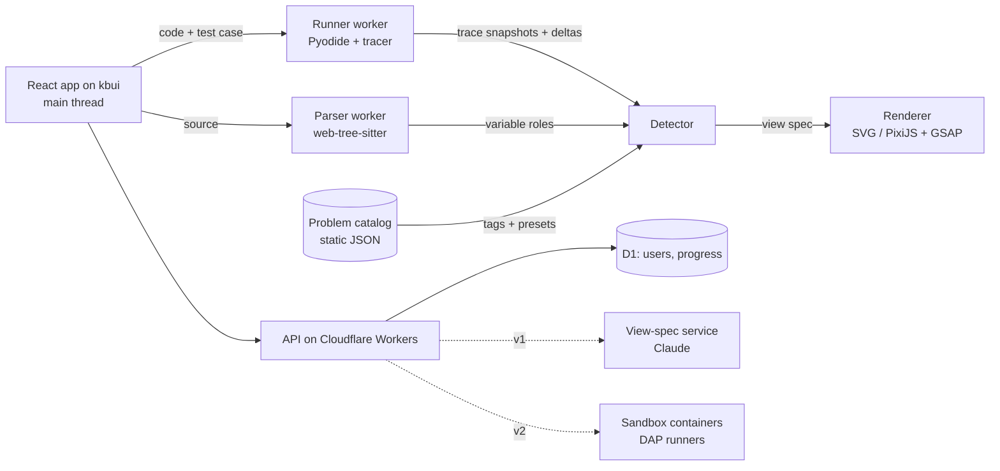

# Architecture

How Stepwise is put together, what each piece is built with, and the budgets and checks that keep it honest. None of it is built yet; this is the design.

## Runtime layout

- **All execution is off the main thread.** The main thread only renders and handles input.
- **Workers talk through Comlink.** Traces cross as structured clones of compact records.
- **Instant stop.** The app is served cross-origin isolated (COOP and COEP headers), so a `SharedArrayBuffer` interrupt flag can stop Pyodide at once.
- **The problem catalog is static.** Statements, starter code, tests, reference solutions and view presets live in this repository as content files and ship with the build.

[Visualization system](visualization.md) covers the trace, detector and renderer in detail.

## Tech stack

Exact versions are pinned when the project starts and upgraded deliberately.

| Layer | Choice | Why | Alternative |
|---|---|---|---|
| Design system | [kbui](https://github.com/KhallilB/kbui): `@kbui/react`, `@kbui/css`, `@kbui/tokens` | Tokens, light and dark themes, accessible components on Base UI; gaps are filled in kbui itself | — |
| App framework | React 19, Vite, React Router 7 (framework mode) on Cloudflare Workers | kbui needs React 19; prerendered library pages, a client-heavy workspace, and easy isolation headers | TanStack Start |
| Language | TypeScript, strict | Trace and view-spec types are the contract between layers | — |
| Client state | Zustand with selectors | Trace and step index live outside React; each view subscribes only to what it draws | `useSyncExternalStore` with a hand-written store |
| Styling | kbui tokens and plain CSS, in a cascade layer after kbui | Same tokens and themes as the components; no raw values, matching kbui's own rule | Tailwind |
| Interaction primitives | Base UI, through kbui | Accessible dialogs, menus, sliders, tabs, toasts and drawers | — |
| Code editor | CodeMirror 6 | Modular and light, works on touch, decoration API suits line highlighting | Monaco |
| Python runtime | Pyodide in a Web Worker, traced with `sys.settrace` | Real CPython in the browser; no server cost per run; works offline | Server sandbox (the v2 path) |
| JS/TS runtime (v1) | Instrumented with SWC, run in a sandboxed worker | Native speed; trace hooks inserted per statement | QuickJS in WASM |
| Other languages (v2) | Debug Adapter Protocol runners in Cloudflare Sandbox containers | One protocol for every language; isolation per run | Firecracker microVMs |
| Parsing | web-tree-sitter | Incremental, tolerates half-written code, one query language across languages | Per-language parsers |
| Worker messaging | Comlink | Typed calls across workers | — |
| View motion | GSAP 3 timelines and Flip, through `@gsap/react` | Seekable, reversible timelines map onto steps; durations come from kbui tokens | Motion |
| Interface motion | kbui's CSS transitions | Already tokenized and off under reduced motion | — |
| Drawing, small | SVG from React components, styled with `--kb-viz-*` tokens | Crisp, accessible, follows the theme | — |
| Drawing, large | PixiJS v8 | Thousands of cells or nodes at 60 fps | Canvas 2D |
| Layout math | d3-hierarchy, d3-force, d3-scale, elkjs | Proven tree and graph layouts; math only, React owns the DOM | dagre |
| Local storage | IndexedDB through Dexie | Offline-first drafts, progress, cached traces | — |
| Backend | Cloudflare Workers, D1, KV for cached view specs | Fast at the edge, simple, cheap at small scale | Supabase |
| Auth | Better Auth (email link, GitHub) | Self-hosted, runs on Workers and D1 | Clerk |
| View-spec LLM (v1) | Claude Haiku 5.5 with JSON-schema output; Sonnet 5.5 as fallback | Cheap, fast classification; output validated and never executed | Rules only |
| Testing | Vitest, Playwright, axe-core, fast-check | Unit, end-to-end, visual regression, accessibility, property tests | — |
| Observability | Sentry, PostHog, web-vitals | Errors, funnels and retention, real-user performance | — |
| Hosting | Cloudflare Workers | Isolation headers are easy; Pyodide served from the same origin with a long cache | Vercel |

## Performance

### Budgets

| Measure | Budget |
|---|---|
| Initial JS, library page, gzip | ≤ 120 KB |
| Workspace JS without editor and Pyodide, gzip | ≤ 200 KB |
| Largest Contentful Paint, p75 | ≤ 1.5 s |
| Interaction to Next Paint, p75 | ≤ 100 ms |
| Python ready, cached / cold | ≤ 1.5 s / ≤ 5 s |
| Run and trace 5,000 steps | ≤ 400 ms |
| Render one step | ≤ 8 ms main-thread work |
| Trace memory | ≤ 50 MB per walk |

### How we stay inside them

- Start loading Pyodide on the library page when the browser is idle, and cache it with a service worker.
- Load CodeMirror language packs and tree-sitter grammars on demand.
- Snapshot plus delta storage keeps seeking cheap; view geometry for each snapshot is computed in the worker.
- One DOM write per animation frame; animate only `transform` and `opacity`.
- Switch a view from SVG to PixiJS above its element threshold; window long arrays around active pointers.
- Debounce live mode and cancel stale runs, so only the newest result renders.
- Lighthouse CI and a step-render benchmark enforce the budgets.

## Safety and security

- Learner code runs in a worker with no DOM access. The Pyodide build ships without its network helpers, and the worker's content security policy blocks `connect-src`.
- Hard limits: step cap, wall-clock timeout, interrupt flag, and a worker restart if memory passes the cap.
- v2 server runners: one container per run, no network, CPU and memory quotas, read-only filesystem, destroyed after use, rate-limited per user.
- LLM output is data only: validated against the view-spec schema, never run as code, cached by problem hash.
- Shared links carry a server-stored id, never code or personal data in the URL.
- Code stays on the device unless the learner signs in or shares. Analytics never capture code.

## Testing

- **Golden traces.** Each reference solution's trace is checked in. A tracer change keeps them identical or updates them on purpose.
- **Detector tests.** Golden view choices for every problem, plus property tests that generate random grids, lists and trees and check the classification.
- **Seeded bugs.** Five common wrong solutions per problem (off-by-one, missed visited check, wrong base case) that must each produce a useful jump to failure.
- **Visual regression.** Playwright screenshots of each view at fixed steps, light and dark, at three widths.
- **Accessibility.** axe on every screen in CI, and a keyboard-only end-to-end test of the core loop.
- **Performance.** A benchmark scrubs 5,000 steps and fails the build if frame time passes the budget.

## Analytics

| Event | Properties |
|---|---|
| `problem_opened` | problem id, pattern, source (library, next link, share) |
| `tests_run` | problem id, pass count, fail count, duration |
| `walk_started` | problem id, test case, step count, detected views, trigger (button, live, failure) |
| `walk_navigated` | kind (next, back, scrub, jump, line click), sampled 1 in 10 |
| `view_overridden` | problem id, from view, to view |
| `problem_solved` | problem id, attempts, walks before solving |
| `understanding_rated` | problem id, score |
| `runner_limit_hit` | kind (steps, time, memory) |
