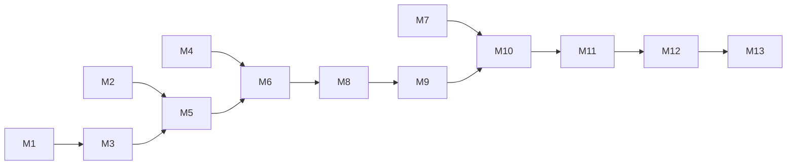

# Roadmap

We only build Stepwise if early testing shows the idea helps. The roadmap is a series of milestones, and each one ends in something we can show: a demo anyone can run, a pass mark we set before the work starts, and evidence we keep.

Estimates assume two engineers and a designer. Weeks count from the day Phase 0 starts, and we'll revisit them once Phase 0 is done.

## Milestones

Status on 2026-10-27.

| | Milestone | Phase | Target | Status |
|---|---|---|---|---|
| M0 | Design published | — | Done | Passed |
| M1 | Clickable prototype | 0 · Validate | Week 1 | Not started |
| M2 | JavaScript tracing check | 0 · Validate | Week 1 | Not started |
| M3 | Learner study | 0 · Validate | Week 2 | Not started |
| M4 | kbui release A | Alongside Phase 0 | Week 2 | Not started |
| M5 | Run and trace | 1 · Core | Week 4 | Not started |
| M6 | First real walkthrough | 1 · Core | Week 6 | Not started |
| M7 | kbui release B | Alongside Phase 1 | Week 6 | Not started |
| M8 | All six views | 2 · First release | Week 8 | Not started |
| M9 | Feedback loop | 2 · First release | Week 9 | Not started |
| M10 | Full library, accessible | 2 · First release | Week 11 | Not started |
| M11 | Private beta | 2 · First release | Week 13 | Not started |
| M12 | v1 | 3 · v1 | Week 19 | Not started |
| M13 | v2 | 4 · v2 | Decided after M12 | Not started |

M3 is the go or no-go point. If it fails, we stop or rethink before writing product code.

## How we record progress

Every milestone has an entry in [`progress.json`](../progress.json). It stays `not-run` until someone checks it against its pass mark. Then the entry records the date, the result, what was measured, links to the evidence and the commit it was checked at. A milestone is never marked done on someone's word alone, and a failed check is recorded as a failure, not deleted.

## Phase 0 · Validate

### M0 · Design published

The product, design and technical docs are public in this repository.

- **Demo:** open the [docs](README.md).
- **Pass mark:** every page in the docs index exists, and every link resolves.
- **Evidence:** this repository.

### M1 · Clickable prototype

A browser prototype that walks through three problems (binary search, two pointers and a grid search) using traces we write by hand. No learner code runs yet. It's enough to put in front of learners.

- **Demo:** open the preview link, pick a problem, step forward and back through a planted bug.
- **Pass mark:** all three problems can be walked forward and back with the line, picture and sentence in sync, on a public preview link.
- **Evidence:** the preview link and a short screen recording.

### M2 · JavaScript tracing check

A throwaway test page that rewrites JavaScript to call a tracing hook and runs it in a worker. It answers whether tracing this way is faithful and fast before we depend on it.

- **Demo:** run the three prototype problems and their planted bugs traced and untraced, side by side, with the timings on screen. Then run `while (true) {}` and press Stop.
- **Pass mark:** traced and untraced runs give the same result on every test, a 5,000-step trace is ready in under 400 ms on a mid-range laptop, and Stop ends an infinite loop within 100 ms.
- **Evidence:** the benchmark script and its results, in `research/`.

### M3 · Learner study

Eight sessions with visual learners using the M1 prototype. Each fixes a planted bug once with Stepwise and once with print statements.

- **Demo:** the study write-up, with timings for every participant.
- **Pass mark:** at least 5 of 8 fix the bug faster with Stepwise, and at least 30% of walkthroughs use step-back or scrub.
- **Evidence:** the study report in `research/`, with session notes and recordings kept privately.

### M4 · kbui release A

The first batch of kbui components Stepwise needs: visualization colors, resizable panels, the timeline slider, tabs, key labels, the screen-reader announcer and code colors (G1 to G7 in [Building on kbui](kbui.md)).

- **Demo:** each new component in kbui's Storybook.
- **Pass mark:** a tagged kbui release with all seven, passing kbui's checks, installed in Stepwise from its release tarball.
- **Evidence:** the kbui release page and its CI run.

## Phase 1 · Core

### M5 · Run and trace

The real JavaScript runner and tracer, with traces stored and replayable.

- **Demo:** paste a solution into a bare test page, run it, and print the trace. Then run `while (true) {}` and press Stop.
- **Pass mark:** traces for two problems match their stored copies exactly, a 5,000-step trace is ready in under 400 ms, and Stop ends an infinite loop within 100 ms without freezing the tab.
- **Evidence:** CI run with the stored-trace and runaway-code tests.

### M6 · First real walkthrough

The editor, step controls, and the array and grid views, working on real code end to end.

- **Demo:** on the preview link, write a binary search with an off-by-one bug, walk through it, and watch the pointers miss the target.
- **Pass mark:** two problems work end to end. Each step draws in under 8 ms and scrubbing 5,000 steps stays above 50 fps.
- **Evidence:** the preview link, a screen recording and the performance benchmark from CI.

### M7 · kbui release B

The rest of the first-release components: drawer, table, toast, popover, collapsible section, loading placeholder, empty state, keyboard shortcuts and split layouts (G8 to G15 and G20).

- **Demo:** each new component in kbui's Storybook.
- **Pass mark:** a tagged kbui release with all nine, passing kbui's checks, installed in Stepwise.
- **Evidence:** the kbui release page and its CI run.

## Phase 2 · First release

### M8 · All six views

The linked list, binary tree, hash map and recursion tree views join array and grid, and Stepwise starts choosing views on its own.

- **Demo:** walk through one problem of each kind and watch the badge name the right view.
- **Pass mark:** the intended view is chosen for all 30 reference solutions, and the wrong one for no more than 15% of a set of common learner solutions.
- **Evidence:** CI run with the view-choice tests and the learner-solution results.

### M9 · Feedback loop

Narration, jump to failure and live mode.

- **Demo:** introduce a bug, run the tests, and land on the failing step with a sentence explaining it. Then turn on live mode and fix the bug while the picture updates.
- **Pass mark:** every planted bug (five per problem) opens at a useful step, no step is missing a sentence, and a minute of continuous typing in live mode never shows a blank view.
- **Evidence:** CI run with the planted-bug suite and the live-mode test.

### M10 · Full library, accessible

All 30 problems in the library, and the product checked for accessibility.

- **Demo:** complete a problem from the library to a passing solution using only the keyboard, then again with VoiceOver on.
- **Pass mark:** 30 problems live, no automated accessibility violations on any screen, the keyboard-only test passes, and a manual VoiceOver and NVDA check finds no blocking issues.
- **Evidence:** CI run with the accessibility scans, and the manual check notes.

### M11 · Private beta

Fifty learners using the first release.

- **Demo:** the beta dashboard showing real usage.
- **Pass mark:** 50 learners invited and active, at least 99.5% of sessions without a crash, and all [success measures](product.md#how-well-measure-it) reported after two weeks.
- **Evidence:** the beta report with dashboard snapshots.

## Phase 3 · v1

### M12 · v1

Predict mode, comparison with a reference solution, click-to-jump, graph, DP table and heap views, TypeScript and Python, pasted problems, and share links.

- **Demo:** a shared link that opens someone else's walkthrough at a chosen step.
- **Pass mark:** in beta, 60% of new visitors finish a walkthrough in their first session and 25% return within a week.
- **Evidence:** the v1 beta report.

## Phase 4 · v2

### M13 · v2

More languages running on our servers, and tools for instructors. We'll set the scope and pass mark after M12, based on what v1 teaches us.

## Risks

| Risk | What we'll do about it |
|---|---|
| Stepwise picks the wrong view and learners stop trusting it | Set views per problem, show the choice, make switching one click, and fall back to the general view when unsure |
| Rewriting code to trace it changes how it behaves | Run every reference solution and planted bug traced and untraced in CI, and fail on any difference. M2 checks this early. |
| Learners preparing for interviews want Python | Ask Phase 0 participants which language they practice in, and bring Python forward if most say Python |
| Big inputs make traces too large | Use small inputs for walkthroughs, cap the steps, and store traces compactly |
| Animation slows experienced users down | Snap at higher speeds, let any keypress cut an animation short, offer reduced motion |
| Bigger platforms add visuals of their own | Compete on how good the views, narration and failure diagnosis are, not on problem count |
| Problem content causes legal trouble | Write every problem ourselves |
| kbui work holds up Stepwise | Start the kbui work early and build the views in parallel |
| kbui's warm visual style feels wrong for learning | Keep data colors separate from the theme, check reactions in M3, and adjust tokens if needed |

## Open questions

- How do we make money: a free core with paid extras, or licenses for schools and bootcamps?
- Do interview candidates need Python sooner than v1?
- If a learner hasn't written anything yet, should Walk through show a reference solution?
- How much should narration explain, and how much should it ask the learner to work out?
- Is a desktop app worth building later for offline use?
