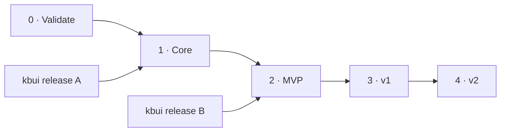

# Roadmap

Stepwise is worth building only if seeing your own code run as a picture helps visual learners fix bugs faster. The roadmap tests that first, then builds in phases, each with exit criteria set before the work starts.

Estimates assume two engineers and one designer, and are revisited after Phase 0.

## Phases

Status on 2026-10-27: nothing started.

| Phase | Length | Delivers | Exit criteria |
|---|---|---|---|
| 0 · Validate | 2 weeks | Clickable prototype with 3 problems; 8 sessions with visual learners; seeded-bug task timed against print debugging | Assumptions [A1 and A4](product.md#assumptions-to-test) hold. If A1 fails, stop or rethink. |
| kbui release A | alongside Phase 0 | G1–G7: viz and code tokens, resizable panels, timeline slider, tabs, Kbd, announcer | Release installs in Stepwise; kbui checks pass |
| 1 · Core | 4 weeks | Pyodide runner, tracer, trace store, editor, step controls, array and grid views | Two problems work end to end within the [performance budgets](architecture.md#budgets) |
| kbui release B | alongside Phase 1 | G8–G15 and G20: drawer, table, toast, popover, collapsible, skeleton, empty state, shortcuts, layout intents | Released before the MVP beta |
| 2 · MVP | 5 weeks | The other four views, detector, narration, jump to failure, live mode, library, 30 problems, accessibility pass | Golden tests green; private beta with 50 learners |
| 3 · v1 | 8 weeks | Predict mode, divergence diff, click to time-travel, graph, DP and heap views, JS/TS, bring your own problem, share links | Activation ≥ 60% and D7 ≥ 25% in beta |
| 4 · v2 | 10+ weeks | Server runners for more languages, instructor mode | Decided by v1 results |

## Risks

| Risk | Impact | Mitigation |
|---|---|---|
| Detector picks the wrong view | Learners lose trust in the picture | Presets for catalog problems, a visible badge, one-click switch, remembered pins, a confidence threshold with a generic fallback |
| Pyodide cold start is slow | First visit feels broken | Preload when idle, service-worker cache, editor usable while loading, prefilled demo |
| Traces get huge on big inputs | Memory use and jank | Small sample inputs, step cap, value windowing, snapshot plus delta storage |
| Animation gets in the way at speed | Feels sluggish to experienced users | Snap at 2× and above, interruptible tweens, reduced-motion option |
| Incumbents add visuals | Less to set Stepwise apart | Focus on detection quality, narration and failure diagnosis, not problem count |
| Problem content legality | Takedown | All statements original; no names or numbers borrowed from other platforms |
| kbui work blocks the product | Phases slip | Front-load release A; build views, which need no new components, in parallel; time-boxed temporary components |
| kbui's warm theme feels wrong for a learning tool | Weaker first impression | Data meaning lives in viz tokens, not the theme; check impressions in Phase 0; a Stepwise theme stays possible through tokens |
| Base UI upgrades change behavior | Controls behave differently | Upgrade inside kbui with its story tests, never directly in Stepwise |

## Open questions

- Business model: a free core with a paid tier (bring your own problem, more languages, instructor tools), or free with institutional licenses?
- Which second language matters most to the target learners: JavaScript or Java?
- When the learner has written nothing yet, should a walk default to their code or a reference solution?
- How much should narration explain, and how much should it prompt the learner to think?
- Is a desktop app worth it later, for offline use and local language toolchains?
