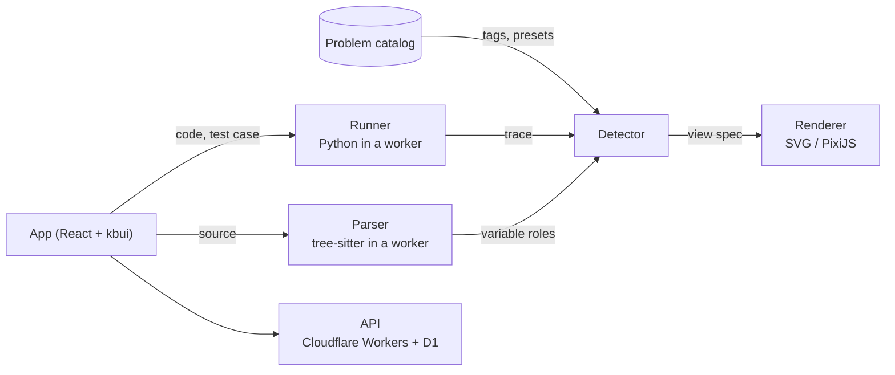

# Technical design

## How it fits together

Learner code never runs on the page itself. It runs in background workers, and the page only draws and handles input. That keeps stepping smooth and stops a runaway loop from freezing the tab.



There are three stages, and they only talk to each other through two data formats. The **runner** executes the code and records a **trace** of every step. The **detector** reads that trace alongside the source and produces a **view spec** saying what to draw. The **renderer** draws it. Adding a language means writing a runner; adding a view means writing a renderer. [Decision 0004](decisions/0004-trace-and-view-spec-contracts.md) explains why.

Problems, starter code, tests, reference solutions and view presets live in this repository as content files and ship with the app.

## Stack

| Area | Choice |
|---|---|
| Interface | React 19 and [kbui](https://github.com/KhallilB/kbui), styled with plain CSS on kbui's tokens |
| App and hosting | React Router 7 on Cloudflare Workers |
| Language | TypeScript in strict mode |
| Running Python | Pyodide in a Web Worker, traced with `sys.settrace` |
| Reading code | web-tree-sitter |
| Editor | CodeMirror 6 |
| App state | Zustand |
| Drawing | SVG for small views, PixiJS once they get large |
| Animation | GSAP timelines, timed by kbui's motion tokens |
| Tree and graph layout | d3-hierarchy, d3-force, elkjs |
| Saving on the device | IndexedDB through Dexie |
| Backend | Cloudflare Workers, D1 and KV |
| Sign-in | Better Auth, with email links and GitHub |
| Testing | Vitest, Playwright, axe-core, fast-check |
| Monitoring | Sentry and PostHog |

Later releases add JavaScript instrumented with SWC (v1), a Claude model that suggests views for problems learners paste in (v1), and isolated server runners for other languages (v2). We'll pin exact versions when the project starts.

## Choosing a view

Each variable gets a score from three signals. Half of it comes from the **shape** of the value: a list of equal-length lists looks like a grid. Thirty percent comes from **how the code uses it**: in `nums[lo]`, `lo` is a pointer into `nums`. The last twenty percent comes from the **problem's tags**, so a problem tagged `grid-bfs` leans toward the grid view.

If no view scores above 60%, we fall back to the general view. If two views land within 10% of each other, the badge shows a question mark ("Grid?") and offers the other option. Whatever the learner picks always wins, and we remember it.

## Data formats

The **trace** has one record per step: the line, what happened, the call stack with its local variables, and the objects in memory. Each object keeps one id, so two names pointing at the same list draw as one list. To keep things fast, we store a full snapshot every 64 steps and only the differences in between. Lists over 1,000 items keep just the part around where the code was looking.

```ts
type Step = {
  line: number;
  event: "line" | "call" | "return" | "exception";
  tags: ("compare" | "assign" | "append" | "pop" | "branch" | "index")[];
  stack: { fn: string; line: number; locals: Record<string, Value> }[];
  heap: Record<HeapId, HeapObj>;
  exception?: { type: string; message: string };
};
```

The **view spec** lists up to three main views and what each one is bound to. Here's one for a grid search:

```json
{
  "confidence": 0.92,
  "badge": "Grid + BFS",
  "views": [
    { "type": "grid", "bind": "grid", "cursor": ["r", "c"],
      "overlays": [{ "set": "seen", "style": "visited" }] },
    { "type": "array", "bind": "q", "pointers": [] }
  ]
}
```

The full type definitions are in the [original spec](specs/2026-10-27-stepwise-spec.html).

## Problem set

The first release has 30 problems:

| Pattern | Problems | Main view |
|---|---|---|
| Arrays and hashing | 4 | Array, hash map |
| Two pointers | 3 | Array with pointers |
| Sliding window | 3 | Array with a window |
| Binary search | 3 | Array with lo, mid and hi |
| Stack | 2 | Array used as a stack |
| Linked list | 4 | Linked list |
| Trees | 4 | Binary tree, recursion tree |
| Grid search | 4 | Grid |
| Recursion and backtracking | 3 | Recursion tree |

## Performance

| Measure | Target |
|---|---|
| JavaScript on the library page (gzip) | 120 KB or less |
| Main content visible, 75th percentile | 1.5 s or less |
| Response to input, 75th percentile | 100 ms or less |
| Python ready, cached / first visit | 1.5 s / 5 s |
| Tracing 5,000 steps | 400 ms or less |
| Drawing one step | 8 ms or less |
| Memory per walkthrough | 50 MB or less |

Python starts downloading in the background on the landing page and is cached for later visits. Editor language packs load only when needed. Large views switch from SVG to PixiJS, and long arrays only draw the part near the pointers. Live mode waits for a pause in typing and drops any run that's already out of date. CI fails the build if we go over these numbers.

## Safety and privacy

Learner code runs in a worker that can't touch the page or the network. Runs stop at 5,000 steps, 3 seconds or a memory cap, and the Stop button responds within 100 ms. The page is served with cross-origin isolation headers, which is what lets us interrupt Python instantly.

Code stays on the learner's device unless they sign in or share a link. Shared links carry an id, never code or personal details, and analytics never record what anyone writes. In v1, anything the model returns is checked against the view-spec format and treated as data, never run. In v2, each server run gets its own container with no network, fixed limits and a read-only filesystem, and is destroyed afterwards.

## Testing

- **Stored traces.** Each reference solution's trace is checked in, so any change to tracing shows up as a diff.
- **View choice.** Every problem has an expected view, and randomly generated lists, grids and trees check the detector beyond the catalog.
- **Planted bugs.** Five common mistakes per problem, such as an off-by-one or a missing visited check. Each one has to open at a useful step.
- **Screenshots.** Every view at fixed steps, in light and dark, at three widths.
- **Accessibility.** Automated scans on every screen, plus a keyboard-only run through the core loop.
- **Performance.** A benchmark scrubs through 5,000 steps and fails the build if it slows down.

## Analytics

We track a small set of events to measure the [product goals](product.md#how-well-measure-it): a problem opened, tests run, a walkthrough started, how learners move through it (sampled), a view switched, a problem solved, the understanding rating, and runs that hit a limit. None of them include code.
