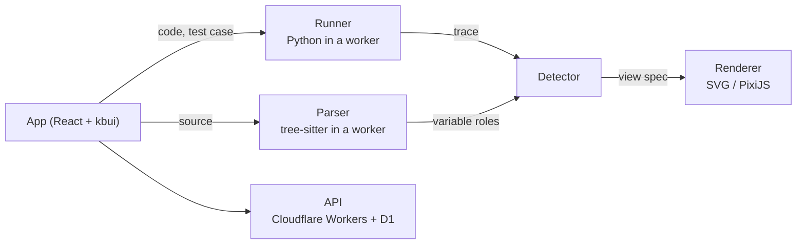

# Technical design

## Overview

All code execution happens in the browser, off the main thread. The page only draws and handles input.



The system has three stages connected by two data formats:

1. The **runner** executes the code and records a **trace**: every step's line, call stack and variables.
2. The **detector** reads the trace and the source and produces a **view spec**: which views to draw and what each one shows.
3. The **renderer** draws the view spec for the current step.

A new language only needs a new runner. A new view only needs a new renderer. See [decision 0004](decisions/0004-trace-and-view-spec-contracts.md).

## Stack

| Area | Choice |
|---|---|
| UI | React 19, [kbui](https://github.com/KhallilB/kbui), plain CSS on kbui tokens |
| App and hosting | React Router 7 on Cloudflare Workers |
| Language | TypeScript, strict |
| Python runtime | Pyodide in a Web Worker, traced with `sys.settrace` |
| Code parsing | web-tree-sitter |
| Editor | CodeMirror 6 |
| State | Zustand |
| Drawing | SVG for small views, PixiJS for large ones |
| Animation | GSAP timelines, timed by kbui motion tokens |
| Layout | d3-hierarchy, d3-force, elkjs |
| Local storage | IndexedDB via Dexie |
| Backend | Cloudflare Workers, D1, KV |
| Auth | Better Auth (email link, GitHub) |
| Testing | Vitest, Playwright, axe-core, fast-check |
| Monitoring | Sentry, PostHog |

Later releases add SWC-instrumented JavaScript (v1), a Claude model that proposes view specs for pasted problems (v1), and sandboxed server runners for other languages (v2).

## How views are chosen

Each variable is scored on three signals:

- **Shape** of the value (50%). A list of equal-length lists is a grid.
- **Use** in the code (30%). In `nums[lo]`, `lo` is a pointer into `nums`.
- **Problem tags** (20%). A problem tagged `grid-bfs` favors the grid view.

Below 60% confidence, the general view is used. When two views score within 10% of each other, the badge shows a question mark and offers the alternative. A learner's choice always wins.

## Data formats

**Trace.** One record per step. A full snapshot is stored every 64 steps with small differences in between, so any step loads quickly.

```ts
type Step = {
  line: number;
  event: "line" | "call" | "return" | "exception";
  tags: ("compare" | "assign" | "append" | "pop" | "branch" | "index")[];
  stack: { fn: string; line: number; locals: Record<string, Value> }[];
  heap: Record<HeapId, HeapObj>; // shared objects keep one id
  exception?: { type: string; message: string };
};
```

**View spec.** At most three primary views per step.

```json
{
  "confidence": 0.92,
  "badge": "Grid + BFS",
  "views": [
    { "type": "grid", "bind": "grid", "cursor": ["r", "c"],
      "overlays": [{ "set": "seen", "style": "visited" }] },
    { "type": "array", "bind": "q", "pointers": [] }
  ]
}
```

The [original specification](specs/2026-10-27-stepwise-spec.html) has the full type definitions.

## Performance targets

| Measure | Target |
|---|---|
| Library page JavaScript (gzip) | ≤ 120 KB |
| Largest Contentful Paint, p75 | ≤ 1.5 s |
| Interaction latency, p75 | ≤ 100 ms |
| Python ready, cached / first visit | ≤ 1.5 s / ≤ 5 s |
| Trace 5,000 steps | ≤ 400 ms |
| Render one step | ≤ 8 ms |
| Memory per walkthrough | ≤ 50 MB |

Python starts loading in the background on the landing page and is cached for later visits. CI enforces these targets.

## Safety

- Learner code runs in a worker with no access to the page or the network.
- Runs stop at 5,000 steps, 3 seconds or a memory cap. The Stop button responds within 100 ms.
- Code stays on the device unless the learner signs in or shares a link. Analytics never record code.
- Model output in v1 is validated as data and never executed.
- v2 server runs use one isolated container per run with no network access.

## Testing

- **Golden traces:** each reference solution's trace is stored and compared on every change.
- **View selection:** each problem's expected views are tested, along with randomly generated lists, grids and trees.
- **Planted bugs:** five common mistakes per problem, each of which must open at a useful step.
- **Visual regression:** screenshots of every view in light and dark at three widths.
- **Accessibility:** automated scans on every screen and a keyboard-only test of the core loop.
- **Performance:** a benchmark that fails the build if stepping slows past target.
